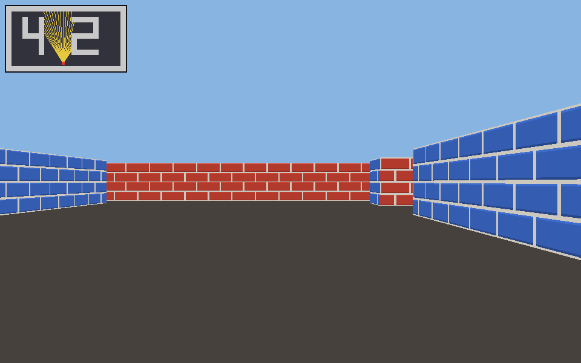

# cub3D

## Описание

Мини-игра от первого лица, написанная на C#, в которой можно ходить, в которой стены с текстурами, пол и потолок — сплошными цветами.
Для каждого столбца экрана пускается луч по клетчатой карте, алгоритм DDA находит ближайшую стену, и столбец закрашивается полосой высотой H / d, где d — расстояние до стены по направлению взгляда.

### Запуск

Карты:

dotnet run -c Release --project src/Cub3D -- maps/simple.cub  
dotnet run -c Release --project src/Cub3D -- maps/irregular.cub  
dotnet run -c Release --project src/Cub3D -- maps/maze.cub  
dotnet run -c Release --project src/Cub3D -- maps/bonus.cub
dotnet run -c Release --project src/Cub3D -- maps/42.cub

При неверных аргументах — справка и код 2, при ошибке в карте — `Error`, причина и код 1.

## Управление

| Клавиша | Действие |
|---|---|
| W / S | вперёд / назад |
| A / D | шаг влево / вправо |
| ← / →, мышь | поворот |
| Shift | бег |
| E | открыть / закрыть дверь |
| M | мини-карта |
| F | затенение |
| Esc | выход |

Ошибка выдаётся с номером строки и колонки, например `строка 9, колонка 4: недопустимый символ '2' в карте`. Примеры ошибочных карт — в `maps/bad/`.

Пересоздать текстуры и лабиринт: `dotnet run --project tools/Generate`.

## Тесты

dotnet test                                                 # все тесты
dotnet test --filter "FullyQualifiedName~PublicTests"       # публичные тесты
dotnet test --filter "FullyQualifiedName~ParserTests"       # разбор карт
dotnet test --filter "FullyQualifiedName~PlayerTests"       # игрок и движение
dotnet test --filter "FullyQualifiedName~RaycastTests"      # лучи и двери
dotnet test --filter "FullyQualifiedName~RenderTests"       # построение кадра
dotnet test --filter "FullyQualifiedName~ChickenTests"      # цыплёнок
dotnet test --filter "FullyQualifiedName~PngTests"          # PNG и текстуры
dotnet test --filter "FullyQualifiedName~CliTests"          # аргументы и коды возврата
dotnet format --verify-no-changes                           # стиль кода

## Производительность

| Сцена | Разрешение | Время кадра | FPS |
|---|---|---|---|
| maps/simple.cub | 960×600 | 1,10 мс | ≈ 905 |
| maps/42.cub | 960×600 | 1,39 мс | ≈ 719 |
| maps/irregular.cub | 960×600 | 1,30 мс | ≈ 767 |
| maps/maze.cub | 960×600 | 1,50 мс | ≈ 665 |
| maps/bonus.cub | 960×600 | 1,38 мс | ≈ 725 |
